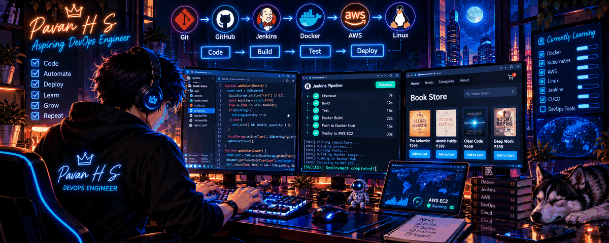
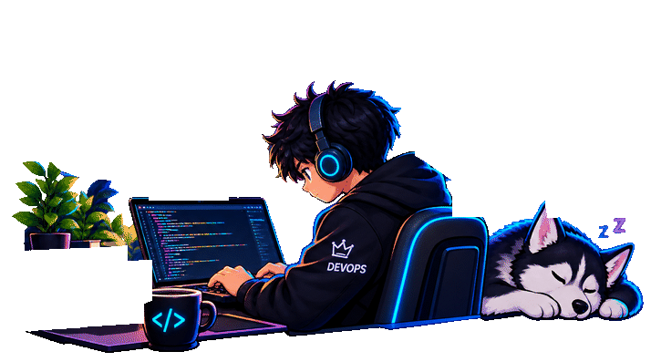
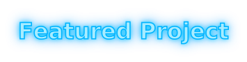

<!-- ========== ANIMATED BANNER ========== -->

  

<h1 align="center"> 👋</h1>

<h3 align="center"></h3>

  Building, Automating, Deploying and Learning 🚀

---

<!-- ========== ABOUT ME + SIDE GIF ========== -->
<h2>👨‍💻 </h2>

<table>
  <tr>
    <td width="60%" valign="top">
      <ul>
        <li>🎓 B.E. graduate in Electronics and Communication Engineering</li>
        <li>🚀 Aspiring DevOps / CI/CD Engineer</li>
        <li>🛠️ Practising Git, GitHub, Jenkins, Docker, Linux and AWS EC2</li>
        <li>💻 Building hands-on DevOps projects</li>
        <li>🌱 Learning CI/CD automation and cloud deployment</li>
        <li>🎯 Working towards an entry-level DevOps engineering role</li>
      </ul>
    </td>
    <td width="40%" align="center" valign="middle">
      
    </td>
  </tr>
</table>

---

<!-- ========== CONNECT WITH ME + GIF ON THE RIGHT ========== -->
<h2>🤝 </h2>

  
  &nbsp;
  
  &nbsp;
  

 
 
 

<!-- ========== LANGUAGES AND TOOLS (ANIMATED ICONS) ========== -->
<h2>🧰 </h2>

  

---

<!-- ========== FEATURED PROJECT ========== -->
<h2>🚀 </h2>

<h3>📚 </h3>

  A web-based bookstore project used to practise application
  development, version control, containerization and deployment.

<ul>
  <li>🌐 Developed a bookstore interface using HTML, CSS and JavaScript</li>
  <li>🔀 Practised version control using Git and GitHub</li>
  <li>🐳 Worked on Docker containerization</li>
  <li>☁️ Practised deployment on AWS EC2</li>
  <li>⚙️ Exploring Jenkins CI/CD automation</li>
</ul>

  

---

<!-- ========== DEVOPS WORKFLOW ========== -->
<h2>⚙️ </h2>

  
  →
  
  →
  
  →
  
  →
  

---

<!-- ========== GITHUB STATISTICS ========== -->
<h2>📊 </h2>

  
  

---

<!-- ========== CURRENT LEARNING ========== -->
<h2>🎯 </h2>

<ul>
  <li>Jenkins pipelines and CI/CD</li>
  <li>Docker and container management</li>
  <li>AWS cloud fundamentals</li>
  <li>Linux administration and Bash scripting</li>
  <li>Terraform and Kubernetes fundamentals</li>
</ul>

---

  <b>BUILD • AUTOMATE • DEPLOY • LEARN • REPEAT</b>

